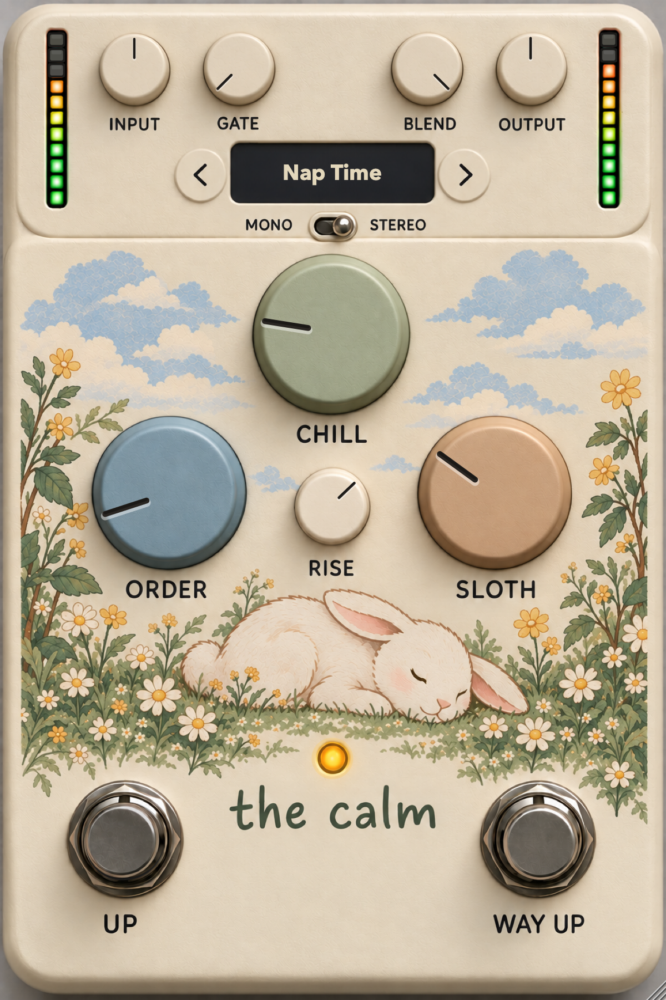

# The Calm

**An octave pedal that ruins everything, calmly.**

The Calm shifts your guitar up one or two octaves with a grainy, slightly broken pitch shifter, then lets
you detune it, scramble it and turn it into a resonant mess. It is built for momentary, foot-pressed
octave jumps: hold a switch, the pitch rises; let go, it's back.

<p align="center"></p>

- Formats: **VST3, AU, CLAP** on macOS (Apple Silicon and Intel, macOS 11+);
  **VST3 and CLAP** on Windows (x64; on Windows on ARM they run in x64 and ARM64EC hosts such as REAPER).
- Stereo or mono, any sample rate, low CPU usage.

## Controls

| Control | What it does |
|---|---|
| **UP** | Hold for **+1 octave**. Right-click → **Latch** to make it a toggle. |
| **WAY UP** | Hold for **+2 octaves**. Right-click → **Latch**. Only one octave switch is active at a time. |
| **RISE** | How long the pitch takes to glide up when you press a switch (0 – 1.5 s). Release is instant. Right-click → **Tempo Sync** to set it in note values (1/32 – 2 bars) instead. |
| **CHILL** | Adds two detuned voices around the octave: from a gentle chorus to dissonant chaos. |
| **ORDER** | Random pitch wobble and stutter. Low settings drift, high settings fall apart. |
| **SLOTH** | A resonant comb in front of the shifter: metallic ringing that grows towards the top of the knob. Combined with ORDER it turns into a smeared, unstable drone. |
| **INPUT** | Input gain, −24 to +24 dB. |
| **GATE** | Noise gate threshold. Fully left is **Off**. |
| **BLEND** | Dry/wet mix while a switch is engaged. |
| **OUTPUT** | Output gain, −24 to +24 dB. |
| **MONO / STEREO** | Stereo processes each channel; Mono sums to one channel first. |
| Meters | Input (left) and output (right), −30 to 0 dB. |
| LED | Lights while an octave is engaged. |

Tips:
- Hover a knob to see its value; **double-click** resets it. CHILL, ORDER and SLOTH start at 12 o'clock.
- The window can be resized from the corner; its size is remembered with your project.

## Presets

The display at the top shows the current preset; an asterisk means you have changed something since
loading it.

- **‹ ›** step through the presets.
- **Click the display** for the menu: all presets, **Save Preset…**, **Delete**, **Show Presets Folder**.
- Nine factory presets are built in and also appear as the plugin's programs in your DAW.
- Your presets are files in `~/Library/Application Support/The Calm/Presets` (macOS) or
  `%APPDATA%\The Calm\Presets` (Windows), so they are easy to back up and share.
- Presets store the sound only: footswitch states, Latch and Mono/Stereo are left as they are.

## MIDI control

Every knob, both footswitches and the Mono/Stereo switch can be played from a MIDI controller or a
footswitch.

1. Right-click the control → **MIDI Learn** (it gets a red outline).
2. Move a controller or press a key/pad — it is assigned.
3. Right-click → **Clear MIDI** removes it.

Footswitches react to CC values ≥ 64 or note-on as "pressed"; in Latch mode each press toggles.
Assignments are saved with your project. In your DAW, route MIDI to the track with The Calm
(Logic: choose the MIDI source in the plugin window's header).

## Installing

Download the installer for your system from the Releases page.

- **macOS** — `TheCalm-<version>-macOS.pkg`. Click **Customize** to choose formats. The installer is not
  signed: if macOS blocks it, open **System Settings → Privacy & Security** and click **Open Anyway**.
- **Windows** — `TheCalm-<version>-Windows.exe`. Choose VST3 and/or CLAP. Plugins go to
  `C:\Program Files\Common Files\VST3` and `…\CLAP`.

Rescan plug-ins in your DAW if The Calm doesn't show up.

---

## Building from source

Requires CMake 3.22+ and a C++20 compiler (Xcode command line tools on macOS, Visual Studio 2022 on
Windows). JUCE and clap-juce-extensions are git submodules:

```bash
git clone --recursive <repository-url>
cmake -B build -DCMAKE_BUILD_TYPE=Release
cmake --build build --config Release
```

On macOS, development builds also copy the plugins to `~/Library/Audio/Plug-Ins`. Remove those copies
when testing an installed build, so hosts don't list The Calm twice.

Installers:

```bash
tools/make_installer_mac.sh                                            # dist/TheCalm-<version>-macOS.pkg
powershell -ExecutionPolicy Bypass -File tools\make_installer_win.ps1  # dist\TheCalm-<version>-Windows.exe
```

The Windows script builds x64 plugins and needs [Inno Setup](https://jrsoftware.org/isinfo.php) 7.

### Project layout

- `Source/dsp/NoiseEngine.h` — the DSP core, header-only, no JUCE dependency.
- `Source/PluginProcessor.*`, `Source/PluginEditor.*` — plugin wrapper and UI.
- `Source/PresetManager.*`, `Source/MidiLearn.*` — presets and MIDI Learn.
- `Resources/skin_source.png` — UI artwork as drawn (1024 × 1536).
- `Resources/skin.png`, `Source/SkinLayout.h` — generated from it by `tools/prepare_skin.py`, which finds
  every control on the artwork (and erases painted knob pointers, if any). Re-run it after changing the
  artwork; a different layout needs its approximate positions updated at the top of the script.
- `installer/TheCalm.iss` — Windows installer (Inno Setup).

### Tests and tools

- `calm_tests` — MIDI Learn, presets, defaults, editor size (`build/calm_tests_artefacts/Release/calm_tests`).
- `calm_stress` — CPU table and a randomized torture test (automation, presets, block sizes, sample rates).
- `ui_snapshot` — renders the UI to PNG without a host: `ui_snapshot out.png 600 preset="Nap Time" octave1=1`.
- `calm_render` — runs the DSP core offline on WAV files.
- `tools/*.py` — test signals, capture matrices through any plugin (via
  [pedalboard](https://github.com/spotify/pedalboard)), and analysis/A-B comparison of pitch, rise,
  modulation and spectra. Set up with `python3 -m venv .venv && .venv/bin/pip install numpy scipy soundfile matplotlib pedalboard`.

## License

Copyright © 2026 BetaRabbit.

The Calm is free software: you can redistribute it and/or modify it under the terms of the
**GNU Affero General Public License v3.0** as published by the Free Software Foundation. It is
distributed in the hope that it will be useful, but WITHOUT ANY WARRANTY; see [LICENSE](LICENSE).

Third-party components keep their own licences: JUCE (AGPLv3 / commercial), clap-juce-extensions and
the CLAP SDK (MIT), the VST3 SDK (MIT).

Built with [JUCE](https://juce.com) and [clap-juce-extensions](https://github.com/free-audio/clap-juce-extensions).
VST is a registered trademark of Steinberg Media Technologies GmbH.
